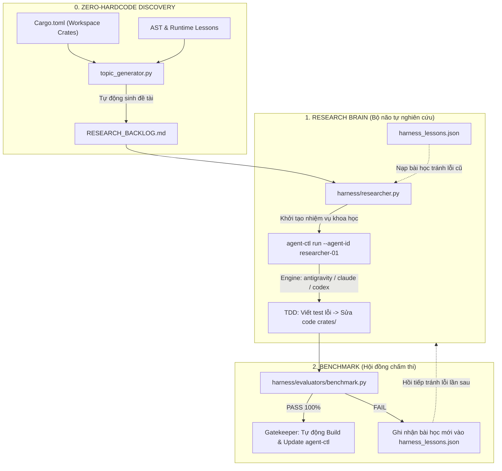

# Tuzygent Continuous Evolution & Research Harness

Tài liệu hướng dẫn vận hành bộ khung thử nghiệm, đánh giá định lượng (Benchmarking) và vòng lặp nghiên cứu - tự động nâng cấp liên tục (**Continuous Evolution & Self-Update Loop**) cho nền tảng Tuzygent Multi-Agent.

---

## 1. Tổng quan & Kiến trúc: "Tự nghiên cứu" diễn ra ở đâu?

Harness không chỉ là bộ chấm thi (chạy test), mà là một hệ thống **Nghiên cứu khoa học tự hành (Scientific Autonomous Research)** gồm 6 thành phần phối hợp khép kín:

| Thành phần | File / Module đảm nhiệm | Vai trò trong quá trình tự nghiên cứu |
| :--- | :--- | :--- |
| **1. Đề tài nghiên cứu** | [`RESEARCH_BACKLOG.md`](file:///home/fox/tuzygent/RESEARCH_BACKLOG.md) & [`IMPROVEMENT_PLAN.md`](file:///home/fox/tuzygent/IMPROVEMENT_PLAN.md) | Chứa danh mục đề tài kiến trúc, ranh giới sandbox, chống panic, tối ưu Task Store. Khi hết, tự động sinh tiếp! |
| **2. Tự sinh đề tài động** | [`harness/topic_generator.py`](file:///home/fox/tuzygent/harness/topic_generator.py) | **Zero-hardcoding**: Quét động AST mã nguồn (`.unwrap()`, `panic!()`), phân vị P90 LOC, và lỗi tái diễn từ runtime. |
| **3. Trí nhớ bài học** | [`storage/harness_memory/harness_lessons.json`](file:///home/fox/tuzygent/storage/harness_memory/harness_lessons.json) | Nhớ các lần giải thất bại trước đó để Agent không lặp lại sai lầm. |
| **4. Bộ não nghiên cứu** | [`harness/researcher.py`](file:///home/fox/tuzygent/harness/researcher.py) & `agent-ctl run` | Trích xuất đề tài, nạp bài học quá khứ, gọi AI Engine (`antigravity`/`claude`/`codex`) để lập giả thuyết và sửa code. |
| **5. Hội đồng chấm thi** | [`harness/evaluators/benchmark.py`](file:///home/fox/tuzygent/harness/evaluators/benchmark.py) | Đo lường khách quan: chạy 68+ tests, Clippy linter, và 4 kịch bản ranh giới. |
| **6. Cấp phép Release** | [`harness/orchestrator.py`](file:///home/fox/tuzygent/harness/orchestrator.py) & `agent-ctl update` | Nếu điểm số cao hơn và không có lỗi mới, tự động build release và thay thế nhị phân hệ thống. |



---

## 2. Hướng dẫn sử dụng nhanh (Quickstart)

Script điều phối chính nằm tại [`scripts/run_harness.sh`](file:///home/fox/tuzygent/scripts/run_harness.sh).

### 2.1. Quét mã nguồn và tự động phát hiện đề tài mới (Zero-Hardcode)
Hệ thống tự động phân tích tĩnh cây mã nguồn Rust để tìm các điểm rủi ro panic (`.unwrap()`), tệp nguyên khối vượt phân vị P90 LOC, và bóc tách lỗi từ `HarnessMemoryStore`:
```bash
./scripts/run_harness.sh --discover
# Hoặc viết tắt:
./scripts/run_harness.sh -d
```

### 2.2. Kích hoạt Chế độ Tự Nghiên Cứu Liên Tục (Autonomous Continuous Loop)
Để hệ thống **tự động chạy liên tục từ đề tài này sang đề tài khác mà không dừng lại sau mỗi bài**, sử dụng cờ `--continuous` (hoặc `-c`):

```bash
# Chạy liên tục xuyên suốt qua đêm (xong đề tài 1 -> tự nhảy sang đề tài 2, 3,...):
./scripts/run_harness.sh --continuous

# Hoặc giới hạn số lượng đề tài cần hoàn thành trong một phiên (ví dụ 5 đề tài rồi nghỉ):
./scripts/run_harness.sh --research --max-topics 5

# Chạy đơn lẻ 1 đề tài rồi dừng:
./scripts/run_harness.sh --research

# Xem trước kế hoạch nghiên cứu mà không tốn token (dry-run):
./scripts/run_harness.sh --research --dry-run
```

#### Quy trình tự hành trong chế độ Continuous:
1. **Lấy đề tài P0 tiếp theo** từ [`RESEARCH_BACKLOG.md`](file:///home/fox/tuzygent/RESEARCH_BACKLOG.md).
2. **Khởi chạy Agent** tự phân tích, viết test TDD và refactor code.
3. **Gatekeeper đo lường**: Chạy toàn bộ 68+ tests và clippy.
4. **Tự động thẩm định & Cập nhật**:
   - Đánh dấu đề tài là `COMPLETED ✅` trong backlog.
   - Tự động build release và thay thế binary `agent-ctl`.
5. **Nghỉ 3 giây và tự động chuyển sang đề tài tiếp theo** mà không cần người dùng gõ lệnh lại.
6. **Bảo vệ chống kẹt (Circuit Breaker)**: Nếu một đề tài thất bại 2 lần liên tiếp, hệ thống tự động ghi bài học lỗi, đánh dấu `BLOCKED ⚠️` và tiếp tục các đề tài khác để không bị treo vòng lặp.

### 2.3. Chạy đánh giá toàn diện & Tự động nâng cấp binary
Chạy toàn bộ bộ test, clippy, kịch bản scenario. Nếu đạt 100%, hệ thống tự động build bản release và thay thế binary `agent-ctl`:
```bash
./scripts/run_harness.sh
```

### 2.4. Chỉ chạy đo lường Benchmark & Scorecard
Chỉ kiểm tra và in bảng điểm đánh giá, không thay đổi binary:
```bash
./scripts/run_harness.sh --benchmark
# Hoặc viết tắt:
./scripts/run_harness.sh -b
```

Bảng điểm mẫu:
```text
---------------- SCORECARD ----------------
 Unit Tests  : PASS (68 passed, 0 failed) [5.79s]
 Clippy Lint : PASS [0.23s]
 Scenarios   : 4/4 passed
 OVERALL     : ✅ ALL CRITERIA MET
 Report saved: harness/reports/latest_benchmark.json
-------------------------------------------
```

### 2.5. Xem danh sách bài học kinh nghiệm đã tích lũy
Tra cứu các lỗi đã từng xảy ra và cách khắc phục mà hệ thống ghi nhớ:
```bash
./scripts/run_harness.sh --lessons
# Hoặc viết tắt:
./scripts/run_harness.sh -l
```

### 2.6. Kiểm tra cập nhật nhị phân hệ thống
Xác nhận binary `agent-ctl` hiện tại đã khớp với commit mới nhất trên git:
```bash
agent-ctl update --check
```

---

## 3. Cơ chế tự động sinh đề tài hoàn toàn động (Zero-Hardcoding Engine)

Để tránh tình trạng "hết đề tài thì dừng" hoặc "đề tài bị hardcode giả tạo", module [`harness/topic_generator.py`](file:///home/fox/tuzygent/harness/topic_generator.py) được xây dựng dựa trên 100% dữ liệu thực từ codebase:

1. **Tự động nhận diện Workspace Crates**: Phân tích trực tiếp từ root [`Cargo.toml`](file:///home/fox/tuzygent/Cargo.toml), không phụ thuộc vào đường dẫn tĩnh.
2. **Phân tích AST & Quét rủi ro trực tiếp**:
   - Quét chính xác số lượng `.unwrap()` và `.expect()` trong code sản xuất (bỏ qua `tests/`).
   - Quét các lệnh `panic!()` và khối `unsafe {}` để đưa vào đề tài ưu tiên cao (**P0**).
3. **Tính toán phân vị P90 LOC (Statistical Threshold)**:
   - Thay vì dùng con số cố định như 400 hay 500 dòng, hệ thống tính toán phân vị 90% độ dài các file của toàn bộ dự án. Những file vượt ngưỡng P90 sẽ tự động được xếp vào danh mục cần tái cấu trúc (**P2**).
4. **Trích xuất lỗi tái diễn từ Runtime**:
   - Đọc trực tiếp từ `storage/harness_memory/harness_lessons.json`. Những lỗi có `success_count >= 2` được tự động gom thành bài toán kiến trúc cần triệt tiêu tận gốc.
5. **Brainstorm dựa trên mã nguồn hiện tại**:
   - Khi hết đề tài bảo trì mới hoặc chạy `--brainstorm`, generator quét các marker TODO/FIXME, API công khai chưa được nhắc tới trong Rust tests, và kiểu `Serialize`/`Deserialize` chưa có test.
   - Mỗi đề tài nêu file, symbol hoặc dòng nguồn làm căn cứ; generator không tạo đề tài chỉ từ tên module hay danh sách mẫu cố định.
   - Kết quả chỉ được thêm vào backlog nếu chưa có đề tài cùng tiêu đề.

---

## 4. Cấu trúc thư mục Harness

```text
harness/
├── scenarios/                  # Các kịch bản thử nghiệm thực chiến
│   ├── 01_security_boundary.json     # Cô lập sandbox & chống lộ secret
│   ├── 02_account_rotation.json      # Xoay vòng account khi gặp rate limit
│   ├── 03_memory_persistence.json    # Chống xung đột schema & ghi atomic
│   └── 04_cli_version_update.json    # Kiểm tra version CLI & lệnh self-update
├── evaluators/
│   └── benchmark.py            # Runner đo lường test, clippy và scenarios
├── reports/
│   └── latest_benchmark.json   # Báo cáo kết quả mới nhất dạng JSON
├── topic_generator.py          # Bộ máy tự động quét mã nguồn & sinh đề tài (Zero-Hardcode)
├── memory_bridge.py            # Cầu nối đọc/ghi HarnessLesson schema
├── researcher.py               # Bộ não khởi tạo nhiệm vụ khoa học cho Agent
├── orchestrator.py             # Bộ máy điều phối vòng lặp và cập nhật release
└── README.md                   # Tổng hợp kỹ thuật bằng tiếng Anh
scripts/
└── run_harness.sh              # Entry point dòng lệnh chuẩn
```

---

## 5. Cơ chế trí nhớ tự sửa lỗi (Self-Healing Collective Memory)

Harness kết nối trực tiếp với cấu trúc [`HarnessLesson`](file:///home/fox/tuzygent/crates/agent-runtime/src/harness.rs#L8-L18) của Agent Runtime:

- Khi phát sinh lỗi trong quá trình chạy test hoặc scenario, [`memory_bridge.py`](file:///home/fox/tuzygent/harness/memory_bridge.py) sẽ lưu bài học vào:
  ```text
  storage/harness_memory/harness_lessons.json
  ```
- Mỗi bài học bao gồm:
  - `id`: Mã định danh duy nhất (ví dụ: `les-a1b2c3d4`).
  - `node_type`: Cấu phần gặp sự cố (`cargo_test`, `clippy`, `scenario_check`,...).
  - `error_pattern`: Đoạn log lỗi đặc trưng.
  - `remediation_strategy`: Chỉ dẫn đối sách giải quyết.
  - `success_count`: Số lần chiến lược đã áp dụng thành công.

Khi kích hoạt Agent tự sửa lỗi thông qua `agent-ctl`, hệ thống sẽ nạp danh sách bài học này vào System Prompt để tránh mắc lại lỗi cũ.

---

## 6. Tự động hóa chu trình nghiên cứu (Continuous Automation)

### Thiết lập chạy định kỳ ban đêm (Cronjob)
Mỗi đêm tự động kiểm tra, quét đề tài mới, thẩm định và cập nhật bản mới:
```bash
crontab -e
```
Thêm dòng sau:
```cron
0 2 * * * cd /home/fox/tuzygent && ./scripts/run_harness.sh >> storage/harness.log 2>&1
```

### Sử dụng kết hợp với Antigravity Slash Commands
- Dùng lệnh `/goal` khi muốn giao cho Agent một chuỗi bài toán cải tiến từ [`RESEARCH_BACKLOG.md`](file:///home/fox/tuzygent/RESEARCH_BACKLOG.md):
  > *"Đọc RESEARCH_BACKLOG.md, chọn 1 mục P0 chưa hoàn thiện, triển khai code và chạy `./scripts/run_harness.sh` để verify rồi cập nhật binary."*
- Dùng lệnh `/schedule` để hẹn giờ kiểm tra và báo cáo tình trạng Harness định kỳ.
